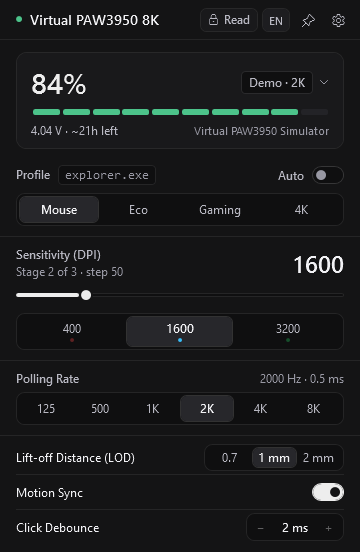
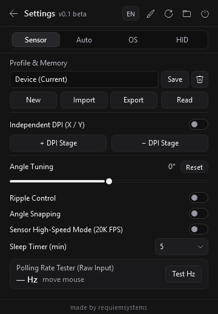
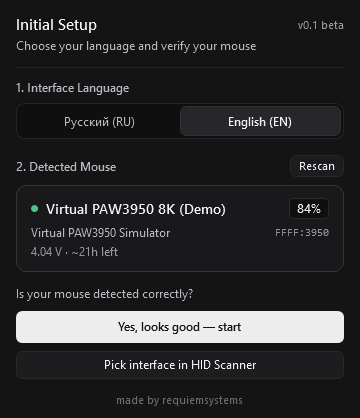

# MouseDeck `v0.1 beta`

[](https://github.com)
[](https://dotnet.microsoft.com/en-us/download/dotnet/9.0)
[](#)
[](LICENSE)

> **made by requiemsystems**

A lightweight, native Windows 11 taskbar flyout for wireless & gaming mice.  
Monitor real-time battery percentage, voltage, active discharge ETA, and CC-CV charging ETA right from your taskbar — and tune DPI, polling rate (up to 8K Hz), LOD, Motion Sync, debounce, and per-app profiles without bloated vendor suites running in the background.

<p align="center">
  
  &nbsp;&nbsp;
  
  &nbsp;&nbsp;
  
</p>

---

## Features

- **Native Windows 11 Taskbar Pill**: Crisp DirectWrite percentage + battery indicator positioned seamlessly beside the system tray, auto-hiding in fullscreen apps and games, with instant click-to-toggle flyout.
- **Zero-Bloat Background Footprint**: Built with C# / `.NET 9` + WPF + direct Win32 USB HID & Bluetooth APIs. No Electron, no WebView, no kernel drivers, and no vendor software conflicts.
- **Safe Read-Only Startup**: Never writes to mouse onboard flash on startup. Onboard memory editing is protected behind an explicit `Read / Write` toggle.
- **Bilingual UI (`EN` / `RU`) & First-Run Setup**: Guided initial setup lets you choose your language and verify the detected mouse; a one-click `EN` / `RU` button sits right on the main header.
- **Smart Battery Telemetry**:
  - 10-segment hardware battery gauge & expandable 24-hour discharge sparkline
  - Active-usage OLS regression for remaining runtime (ignores sleep gaps)
  - 2-phase Li-Ion CC-CV charging ETA (`0–80%` constant current + `80–100%` taper)
- **Full Hardware Tuning** *(supported CompX / Nordic mice)*:
  - DPI stages (up to 8 stages, independent X/Y, mouse-wheel ±50 step), polling rate (`125 Hz – 8K Hz`), LOD (`0.7 / 1 / 2 mm`), Motion Sync, Click Debounce, Angle Tuning, Ripple Control, Angle Snapping, 20K FPS High-Speed Mode, Sleep Timer
  - Automatic per-process profile switching & global hotkeys
- **Universal Mouse Tools** *(works with any mouse)*:
  - Built-in Raw Input Polling Rate (Hz) tester
  - Windows pointer speed, scroll lines, double-click speed, and acceleration toggle
  - Built-in HID interface scanner & raw packet diagnostics

---

## Hardware Support Status (`v0.1 beta`)

MouseDeck uses a multi-tier protocol stack:

| Tier | Protocol / Chipset | Status |
| :--- | :--- | :--- |
| **Full Control + Battery** | **CompX CX52850 / CX52650** (VXE / VGN / ATK / MAD R / MAD 8K / Darmoshark / Zaopin / Incott, etc.) | **Hardware-verified** (tested on VXE MAD R / MAD 8K 8K dongle) |
| **Experimental / Partial** | **Logitech HID++ 2.0**, **Razer HID**, **Nordic nRF52840**, **SteelSeries / Corsair / HyperX** | Implemented — community testing & HID reports welcome |
| **Universal Fallback** | **Bluetooth LE / GATT** battery + **Any USB / Wired OS Mouse** | Battery (BT) + Windows Pointer + Raw Input Hz Tester |

> **Note**: This is an early **`v0.1 beta`** release. If your mouse isn't detected or reports unexpected values, open **Settings → HID**, click **Dump**, and open a **Device Support** issue with the VID:PID and interface details!

---

## Custom JSON Protocols (No Recompile Needed)

MouseDeck automatically loads custom battery/HID definitions from `%AppData%\MouseDeck\protocols\*.json` on startup (and generates a `_example_custom_mouse.json.sample` file there automatically).

Copy [protocols/example-custom-mouse.json](protocols/example-custom-mouse.json) into `%AppData%\MouseDeck\protocols\my-mouse.json` and customize it for any HID wireless mouse:

```json
{
  "ProtocolId": "example-paw3395-mouse",
  "DisplayName": "Example PAW3395 Wireless",
  "VendorIdHex": "0x1D57",
  "ProductIdHex": "0xFA60",
  "UsagePageHex": "0xFF02",
  "UseFeatureReports": true,
  "ReportLength": 17,
  "ReportId": 8,
  "Checksum": "CompX55",
  "BatteryQueryHex": "08 04 00 00 00 00",
  "BatteryPercentOffset": 6,
  "ChargingFlagOffset": 7,
  "VoltageHighOffset": 8,
  "VoltageLowOffset": 9,
  "SupportedPollingRatesHz": [125, 250, 500, 1000, 2000, 4000],
  "MaxDpi": 26000
}
```

### Field Reference
- **`VendorIdHex` / `ProductIdHex` / `UsagePageHex`**: Match your mouse's HID interface (find exact values via **Settings → HID → Dump**; `ProductIdHex` and `UsagePageHex` are optional).
- **`UseFeatureReports`**: `true` for HID Feature Reports (`SetFeature`/`GetFeature`), `false` for Interrupt `Output`/`Input` reports.
- **`Checksum`**: `None`, `CompX55` (`0x55 - sum`), `Sum8`, or `Xor8`.
- **`BatteryQueryHex`**: Raw hex request bytes (test packets live in **Settings → HID → Raw HID Packet** before saving the JSON).
- **`BatteryPercentOffset` / `ChargingFlagOffset` / `VoltageHighOffset` / `VoltageLowOffset`**: Zero-based byte offsets in the response packet (including Report ID at byte `0`). Set voltage offsets to `null` if your mouse does not report mV.

Custom JSON protocols override built-in fallbacks — PRs with verified device definitions are welcome!

---

## Requirements & Installation

- **Windows 11** (64-bit)
- Download from **Releases**:
  - **`MouseDeck-*-win-x64-portable.exe`** (~25 MB) — requires [.NET 9.0 Desktop Runtime (x64)](https://dotnet.microsoft.com/en-us/download/dotnet/9.0)
  - **`MouseDeck-*-win-x64-standalone.exe`** — self-contained, zero external runtime required
- Portable single-file executable; stores configuration in `%AppData%\MouseDeck\`.
- *SmartScreen note*: Because `v0.1 beta` is not yet signed with an EV code-signing certificate, Windows SmartScreen may warn on first run — click **More info → Run anyway**, verify `SHA256SUMS.txt`, or build directly from source below.

---

## Building from Source

```powershell
# Run unit tests (42 tests)
dotnet test MouseDeck.sln -c Release

# Publish portable single-file executable -> dist\MouseDeck.exe
.\publish.ps1

# Publish self-contained standalone executable -> dist\MouseDeck.exe
.\publish.ps1 -Standalone

# Publish both portable & standalone + SHA256SUMS.txt
.\publish.ps1 -All
```

---

## License

MIT License — see [LICENSE](LICENSE) for details.  
*made by requiemsystems*
